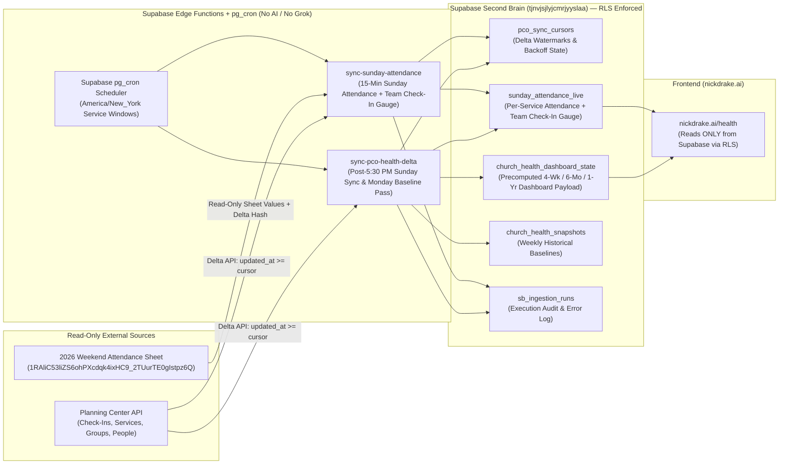

# Automated Planning Center + Attendance Sheet -> Supabase -> Health Dashboard Pipeline Spec (`nickdrake.ai`)

**Status:** Draft Specification (Pending Approval by Nick Drake — No Code or Database Changes Deployed)
**Owner:** Kai - AI & IT Systems Director
**Target Supabase Project:** `Second Brain` (`project_id: tjnvjsjlyjcmrjyyslaa`)
**Strict Boundary:** NEVER touch the `Prayer App` Supabase project (`qzudqbwhfrtijoxorqfg`).

---

## 1. Goal & Core Design Principles

1. **Zero AI / Zero Grok in the Data Loop:** The entire pipeline runs deterministically via scheduled jobs (`pg_cron` invoking Supabase Edge Functions + the existing lightweight Google Sheets trigger). No LLM calls, no Grok wakes, and no AI token spend occur at any stage of ingestion, calculation, or serving.
2. **Maximum Accuracy & Freshness:**
   - **Sunday Live Attendance & Team Check-In Gauge:** Refreshed every **15 minutes** during Sunday service windows so numbers are live within 15 to 30 minutes after each service.
   - **Sunday Final Team Sync:** One complete team serving sync right after the **5:30 PM ET** service wraps.
   - **Monday Morning Late Check-In & Weekly Baseline Pass:** A lightweight delta pass on Monday morning re-checking Sunday attendees for late check-ins and locking the weekly baseline across all 8 Goals and A-Team Health.
3. **Strict Planning Center Rate-Limit Safety:** All Planning Center queries use incremental delta cursors (`where[updated_at][gte]=<last_cursor>`), batched `per_page=100` pagination with `?include=`, and exponential backoff with jitter on HTTP `429` or `5xx`. The pipeline never re-downloads the full roster.
4. **Dashboard Reads Strictly from Supabase:** `https://nickdrake.ai/health` reads exclusively from Supabase tables in `tjnvjsjlyjcmrjyyslaa` with Row-Level Security (`RLS`) enabled on every table. The browser never calls Planning Center or Google Sheets directly.
5. **Privacy & Naming Guardrails:**
   - **Zero Giving Data** and **Zero Non-Staff Attendee Personal Names** stored or exposed in church health summary tables.
   - Always use **`location`** (never `campus`), spell **`Kalie`**, and strip the **`Pastor`** title prefix from staff names so lists sort cleanly.
   - Unique people who serve on Sunday (`Adults Serving`, `Connection`, `Weekend Attendance {team}/{uniq}`, and `A-Team Activity/Inactivity`) are tied strictly to **Planning Center Volunteer Check-Ins (`kind == 'Volunteer'`)**, regardless of whether they confirmed (`C`) in Services.

---

## 2. Architecture & End-to-End Data Flow

---

## 3. Scheduled Job Cadence (`America/New_York`)

All schedules are driven by Supabase `pg_cron` (calling Supabase Edge Functions via `pg_net`) in `America/New_York` time.

| Job Name | Schedule (`America/New_York`) | Cron Expression (ET) | What It Does |
| :--- | :--- | :--- | :--- |
| **`sunday-15m-live-refresh`** | **Every 15 minutes on Sundays** during service windows (**8:00 AM – 7:30 PM ET**, covering morning services through the 5:30 PM service wrap) | `*/15 8-19 * * 0` | 1. Reads the active Sunday row and per-location tabs (`WP`, `OV`, `SF`, `WS`, `HW`) from the 2026 Attendance Sheet. 2. Queries Planning Center Check-Ins delta (`updated_at >= last_cursor` for today's Sunday Volunteer check-ins, `kind = 'Volunteer'`) in a single batched call **folded into the same 15-minute job**. 3. Computes the **Team Check-In Gauge** (how many volunteers checked in vs. scheduled/expected per location and service, for Justin Dailey's visibility) and writes both live attendance and the team check-in gauge to `public.sunday_attendance_live`. |
| **`sunday-post-530pm-team-sync`** | **Sundays at 7:15 PM ET** (right after the 5:30 PM service wraps and check-ins settle) | `15 19 * * 0` | Runs a full Sunday delta pass across Planning Center Check-Ins (`kind = 'Volunteer'` and `kind = 'Regular'`/`'Guest'`) and Services plans for the day. Locks final Sunday unique volunteers served (`{team}/{uniq}`), updates `public.sunday_attendance_live` (`is_live = false`, `services_completed = 'All Services Complete'`), and refreshes `public.church_health_dashboard_state`. |
| **`monday-morning-baseline-pass`** | **Mondays at 6:00 AM ET** (before the 7:00 AM Daily Brief) | `0 6 * * 1` | **Lightweight Monday Pass & Weekly Baseline:** Re-checks only Sunday's check-in events and attendance rows (`updated_at >= sunday_cursor`) to capture any late Sunday check-ins or Monday-morning sheet adjustments, plus 7-day deltas for Groups, Next Steps (Discover, Baptisms, Dream Team), and Outreach. Recomputes the 4-Week, 6-Month (26-Wk), and 1-Year (52-Wk) rollups, writes the canonical weekly snapshot to `public.church_health_snapshots`, and updates `public.church_health_dashboard_state`. |
| **`midweek-delta-heartbeat`** *(Optional)* | **Wednesdays at 5:00 AM ET** | `0 5 * * 3` | Pulls incremental midweek updates (`updated_at >= last_cursor`) for Small Groups attendance/memberships and midweek Serve/Encounter check-ins so midweek Connection metrics stay current without waiting until Sunday. |

### Folding the Team Check-In Gauge into the 15-Minute Refresh
- Rather than running a separate poller for volunteer check-ins, `sunday-15m-live-refresh` performs **one incremental Check-Ins request** (`GET /check_ins/v2/check_ins?where[created_at][gte]=<sunday_start_utc>&where[updated_at][gte]=<last_15m_cursor>&include=locations,event_period,event_times&per_page=100`).
- The Edge Function merges any newly created/updated `kind == 'Volunteer'` check-ins into the cached Sunday volunteer set in `pco_sync_cursors.state_json` and writes the live **Team Check-In Gauge** directly inside `sunday_attendance_live.locs_json` and `sunday_attendance_live.services_json`:
  - `team_checked_in_slots`: total volunteer check-in slots so far per service (`1st`, `2nd`, `3rd`, `4th` / `5:30 PM`).
  - `team_unique_checked_in`: unique individuals checked in as volunteers so far at each location (`WP`, `OV`, `SF`, `WS`, `HW`).
  - `team_sheet_headcount`: headcount entered on the Attendance Sheet (`Exp + Guest Svcs + Kids`), giving Justin Dailey an instant side-by-side gauge of sheet headcount vs. PCO check-in compliance after every service.

---

## 4. Tables Touched & Row-Level Security (RLS)

All tables live in Supabase project **`Second Brain` (`tjnvjsjlyjcmrjyyslaa`)** and enforce `ALTER TABLE ... ENABLE ROW LEVEL SECURITY;`.

### 4.1 Existing Tables Used by the Pipeline
| Table | Role in Pipeline | RLS Policy |
| :--- | :--- | :--- |
| **`public.sunday_attendance_live`** | Stores real-time Sunday per-location (`locs_json`) and per-service (`services_json`) attendance, salvations, baptisms, and the folded **Team Check-In Gauge** (`team_checked_in_slots`, `team_unique_checked_in`, `team_compliance_pct`). | `SELECT`: Authenticated owner (`is_nick_owner()`) and active authorized `/health` viewers (`has_health_dashboard_access()`). `INSERT/UPDATE/DELETE`: `service_role` (Edge Function) and owner only. |
| **`public.church_health_dashboard_state`** | Single-row (`id = 'current'`) precomputed JSONB payload powering `nickdrake.ai/health` (Overview, 8 Goals, Attendance, A-Team Health & Inactivity across 4-Wk, 6-Mo, and 1-Yr horizons). | `SELECT`: Authenticated owner and active `/health` viewers. `INSERT/UPDATE/DELETE`: `service_role` and owner only. |
| **`public.church_health_snapshots`** | Weekly historical baseline snapshots (`as_of_date`, `hw_summary_json`, `sf_summary_json`, `all_locations_json`, `sunday_scheduling_care_md`) written during the Monday morning pass. | `SELECT`: Authenticated owner and active `/health` viewers. `INSERT/UPDATE/DELETE`: `service_role` and owner only. |
| **`public.sb_ingestion_runs`** | Audit log of every scheduled sync run (`source_key`, `status`, `items_scanned`, `external_api_cost_usd = 0`, `started_at`, `completed_at`, `gaps_notes`). | `SELECT/ALL`: Owner (`is_nick_owner()`) and `service_role` only. |

### 4.2 New State Table Required for Delta Sync & Retry Control
| Table | Columns | Purpose & RLS Policy |
| :--- | :--- | :--- |
| **`public.pco_sync_cursors`** *(New)* | `endpoint_key text PRIMARY KEY` `last_updated_at_cursor timestamptz` `last_sheet_hash text` `state_json jsonb` `consecutive_failures int DEFAULT 0` `next_allowed_run_at timestamptz` `last_status text` `last_error text` `updated_at timestamptz` | Stores per-endpoint delta watermarks (`check_ins_sunday`, `services_plans`, `groups_memberships`, `people_steps`, `attendance_sheet_2026`), the running Sunday unique volunteer check-in set, and backoff lockouts. **RLS:** Enabled; strictly restricted to `service_role` and `is_nick_owner()`. |

---

## 5. Planning Center Rate-Limit Strategy

Planning Center enforces a rolling rate limit of **100 requests per 20 seconds** per Personal Access Token (returning `X-PCO-API-Request-Rate-Count`, `X-PCO-API-Request-Rate-Limit`, and `Retry-After` on HTTP `429`). Our pipeline stays well below **5% of that ceiling** via four mechanisms:

1. **Strict Delta Queries (`updated_at >= last_cursor`):**
   - Every PCO request passes `where[updated_at][gte]=<ISO_CURSOR>` (with a 2-minute overlap buffer to prevent clock-skew misses; deduplicated by PCO `id`).
   - On a typical 15-minute Sunday tick, only check-ins created or modified in the last 15 minutes are returned (typically **1 to 3 pages**, or **1 to 3 API calls total**).
   - The pipeline **never** re-downloads the full People, Services, or Check-Ins history.
2. **Compound Includes & Max Page Size (`per_page=100`):**
   - Requests always set `per_page=100` and bundle related objects via `?include=event_period,event_times,locations,person` so the Edge Function never makes N+1 per-person lookups.
3. **Header-Aware Adaptive Pacing:**
   - The Edge Function inspects `X-PCO-API-Request-Rate-Count` and `X-PCO-API-Request-Rate-Limit` on every response.
   - If `Rate-Count >= 70` within the 20-second window, the function sleeps for the remaining window (`X-PCO-API-Request-Rate-Period`) before issuing the next page request.
4. **Fingerprint Short-Circuit on the Attendance Sheet:**
   - Before writing to `sunday_attendance_live`, the function computes a SHA-256 hash of the sheet values + PCO volunteer check-in counts. If nothing changed since `last_sheet_hash`, no redundant downstream recomputation occurs.

---

## 6. Failure Handling & Backoff Policy

1. **Never Hammer a Failing Endpoint (Circuit Breaker & Exponential Backoff):**
   - If Planning Center or Google Sheets returns HTTP `429`, `500`, `502`, `503`, or `504`, the Edge Function reads `Retry-After` (if present) or computes an exponential backoff gap:
     $$\text{Backoff Gap} = \min\left(60\text{ min},\; 5\text{ min} \times 2^{\text{consecutive\_failures}}\right) + \text{jitter}(0..30\text{s})$$
   - Specifically:
     - **1st failure:** waits **5 minutes** (or the next 15-minute cron tick).
     - **2nd consecutive failure:** locks `next_allowed_run_at` for **15 minutes**.
     - **3rd consecutive failure:** locks `next_allowed_run_at` for **30 minutes**.
     - **4th+ consecutive failure:** locks `next_allowed_run_at` for **60 minutes**.
   - While `now() < next_allowed_run_at`, incoming cron ticks exit immediately in `< 10 ms` without touching Planning Center.
2. **Atomic Cursor Advancement:**
   - `pco_sync_cursors.last_updated_at_cursor` is updated **only after** all pages for that window have been fetched and successfully committed to Supabase. If a run fails mid-flight, the next allowed run resumes cleanly from the previous watermark with zero lost records.
3. **Graceful Dashboard Degradation:**
   - Because `nickdrake.ai/health` reads exclusively from `sunday_attendance_live` and `church_health_dashboard_state` in Supabase, a temporary Planning Center outage never breaks or slows down the dashboard. The UI continues serving the last verified snapshot and displays the exact `updated_at` timestamp in Eastern Time (`ET`).
4. **Silent Observability (`app_error_alerts` & `sb_ingestion_runs`):**
   - Every run logs its duration, row count, and status to `public.sb_ingestion_runs` (`model_used = 'none'`, `external_api_cost_usd = 0`).
   - If `consecutive_failures >= 3`, the Edge Function inserts an alert row into `public.app_error_alerts` so it surfaces in the daily 6:00 PM systems audit without waking an AI bot during Sunday services.

---

## 7. Cost Profile

| Component | Usage Pattern | Monthly Cost |
| :--- | :--- | :--- |
| **Grok / LLM Tokens** | **0 calls** (100% deterministic TypeScript in Supabase Edge Functions) | **$0.00 / mo** |
| **Supabase Edge Functions & `pg_cron`** | ~48 Sunday 15-min runs/wk + 1 Sunday 7:15 PM run/wk + 1 Monday 6:00 AM run/wk + 1 Wednesday run/wk = **~220 invocations / month** (included in Supabase plan; < $0.01 in compute) | **$0.00 (Pennies in compute)** |
| **Planning Center API & Google Sheets API** | ~400–600 delta HTTP requests / month total across all jobs | **$0.00 / mo** |

---

## 8. Rollout Plan (Pending Nick's Approval)

Once approved by Nick:
1. **Migration (`tjnvjsjlyjcmrjyyslaa`):** Create `public.pco_sync_cursors` with RLS enabled (`service_role` + `is_nick_owner()` only) and seed initial watermarks from the current Oct 26, 2026 baseline.
2. **Edge Functions:** Update `sync-sunday-attendance` (folding in the PCO Volunteer Check-In Gauge) and deploy `sync-pco-health-delta` using Supabase Secrets (`PCO_APP_ID`, `PCO_SECRET`, `GOOGLE_SERVICE_ACCOUNT_JSON`).
3. **`pg_cron` Schedules:** Register `sunday-15m-live-refresh`, `sunday-post-530pm-team-sync`, and `monday-morning-baseline-pass` in Supabase `pg_cron`.
4. **Frontend Binding (`nickdrake.ai/health`):** Wire `loadAndRenderHealthDashboard()` in `/workspace/nickdrake-ai/app.js` to read the live `church_health_dashboard_state` payload and render the folded Team Check-In Gauge inside the Sunday live banner.
